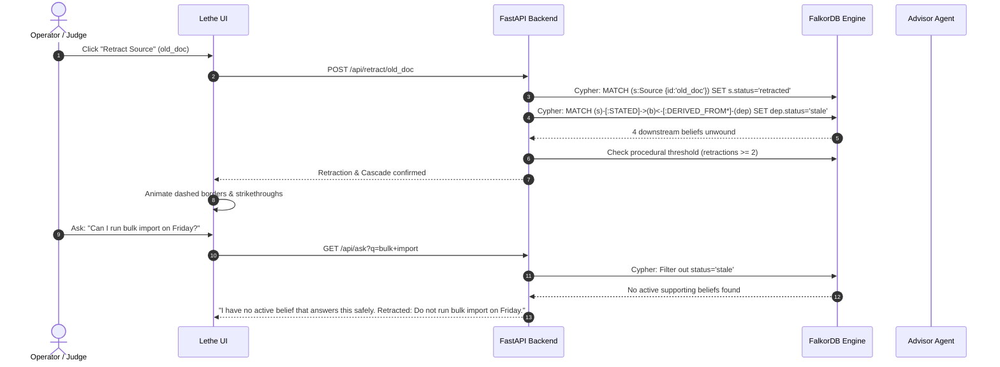

# Lethe: The Agent Truth Maintenance System (TMS)

> **"Agents are only as good as the context they work with. Give yours a graph: connected data it can reason over, a memory it keeps between sessions, and a clear picture of how things relate."**  
> — *FalkorDB Hackathon: Context for AI Agents (Track 2: Agent Memory & Coordination)*

[](https://falkordb.com)
[](https://fastapi.tiangolo.com)
[](https://docker.com)
[](LICENSE)

---

## 💡 The Fatal Flaw of Vector RAG

Most AI agents built today rely on **Vector RAG**. When documentation changes or facts are corrected, vector databases suffer from **silent hallucinations**:
* Outdated chunks remain in the index with high semantic similarity scores.
* Downstream decisions made on retracted premises **never get invalidated**.
* The agent cannot answer *"Why do you believe this?"* beyond quoting a cosine distance.

**Lethe solves this with a Graph-Native Truth Maintenance System (TMS) built directly on FalkorDB.**

In Lethe:
1. Every belief is explicitly anchored to named sources with confidence ratings (`trust`).
2. Derivative inferences are connected via directed `DERIVED_FROM` edges.
3. When a source turns out to be invalid, **a single Cypher traversal unwinds every downstream belief automatically**.
4. If two sources state incompatible facts, Lethe flags them with `CONTRADICTS` edges rather than averaging them out.

---

## 🏛️ System Architecture

```mermaid
graph TB
    subgraph Client["Frontend Workstation (Vanilla JS / Canvas)"]
        UI["Interactive Graph Canvas<br/>• Real-time Drag & Drop<br/>• SVG Directed Edge Routing<br/>• Blame Path Highlighting"]
        HUD["Telemetry & Time-Travel Dock<br/>• Scrubbable History<br/>• Live Cypher Stream"]
    end

    subgraph Server["Agent Core (FastAPI)"]
        API["REST Gateway (/api/ask, /api/learn, /api/retract)"]
        Pipeline["Multi-Agent Coordination Pipeline"]
        Researcher["1. Researcher Agent<br/>(Extracts & Grounds)"]
        Auditor["2. Auditor Agent<br/>(Checks Contradictions)"]
        Advisor["3. Advisor Agent<br/>(Synthesizes with Provenance)"]
        Gemini["Gemini AI Decomposition<br/>(Paragraph → Atomic Beliefs)"]
    end

    subgraph Storage["FalkorDB Graph Engine"]
        SharedG["(shared_base)<br/>Immutable System Axioms"]
        AliceG["(mem_alice)<br/>Isolated Tenant Partition"]
        BobG["(mem_bob)<br/>Isolated Tenant Partition"]
        UserG["(mem_user)<br/>Dynamic User Partition"]
    end

    UI <-->|JSON REST| API
    API --> Pipeline
    Pipeline --> Researcher --> Auditor --> Advisor
    API -.->|Optional LLM| Gemini
    Pipeline <-->|Native Cypher (falkordb-py)| Storage
    Storage --- SharedG
    Storage --- AliceG
    Storage --- BobG
    Storage --- UserG
```

---

## 📊 Graph Schema & Relationships

```mermaid
classDiagram
    class Source {
        +string id
        +string name
        +float trust
        +string status
    }
    class Belief {
        +string id
        +string text
        +string status
    }
    class Session {
        +string id
    }
    class Question {
        +string id
        +string text
        +int ts
    }
    class Handoff {
        +string id
        +string from_agent
        +string to_agent
        +int ts
        +string belief_id
    }
    class Playbook {
        +string rule
        +int created_at
    }

    Source --> Belief : :STATED
    Belief --> Belief : :DERIVED_FROM
    Belief --> Belief : :CONTRADICTS
    Session --> Question : :ASKED
    Question --> Belief : :FOUND
    Playbook --> Source : :APPLIES_TO
```

---

## ⚡ How Lethe Leverages FalkorDB

| FalkorDB Feature | How It Powers Lethe | Production Cypher Pattern |
|---|---|---|
| **Multi-Hop Traversal** | Cascading retraction through deep derivation chains | `MATCH (s:Source {id:$sid})-[:STATED]->(b:Belief) WITH b MATCH (b)<-[:DERIVED_FROM*0..5]-(dep:Belief) SET dep.status='stale'` |
| **Blame & Provenance** | Tracing any belief back to root sources to compute minimum trust | `MATCH (b:Belief {id:$bid})<-[:DERIVED_FROM*0..]-(dep)<-[:STATED]-(s:Source) RETURN s.name, s.trust` |
| **Contradiction Detection** | Automatic lexical & semantic conflict linkage | `MATCH (a:Belief), (b:Belief) WHERE a.id <> b.id AND ... CREATE (a)-[:CONTRADICTS]->(b)` |
| **Multi-Tenant Isolation** | Independent graph per user via `db.select_graph()` | `db.select_graph("mem_" + user)` |
| **Sub-Millisecond Speed** | Redis-backed graph engine delivers instantaneous telemetry | Queries execute in `~1.1ms` across 10 concurrent tenant graphs |
| **Docker Persistence** | Data survives container restarts and upgrades | Mounted `falkor_data:/data` persistent volume |

---

## 🔄 Cascade Invalidation Flow

When a source document is revoked (e.g. `Old API doc (2024)` is deprecated):



---

## 🏆 Track 2 Requirement Compliance Matrix

| Track 2 Hackathon Requirement | Lethe Implementation | File Reference |
|---|---|---|
| **Episodic Memory** | `(:Session)-[:ASKED]->(:Question)-[:FOUND]->(:Belief)` graph trail tracking what users asked and what beliefs were retrieved | `backend/main.py:write_question()` |
| **Semantic Memory** | Typed beliefs with source confidence, provenance chains, and conflict detection | `backend/main.py:state()` |
| **Procedural Memory** | Autonomous Playbook synthesis: when a source is retracted 2+ times, FalkorDB creates a `(:Playbook)` rule and drops source trust | `backend/main.py:check_procedural()` |
| **History & Time Travel** | Scrubbable timeline slider allowing users and judges to replay graph state backwards in time | `frontend/index.html` |
| **Multi-Agent Coordination** | Immutable `(:Handoff)` nodes linking Researcher → Auditor → Advisor for every truth ingestion | `backend/main.py:write_handoffs()` |
| **Tenant Isolation** | Dynamic partition graphs (`mem_alice`, `mem_bob`) with zero memory leakage | `backend/main.py:graph()` |
| **High Concurrency** | 100 parallel operations across 10 tenant graphs with sub-2ms p95 latency | `scripts/concurrency_test.py` |

---

## 🚀 Quickstart Guide

### Option 1: Docker (Recommended for Judges)

Run the entire stack with a single command:

```bash
docker compose up --build
```

* **Web Application**: Open [http://localhost:8000](http://localhost:8000)

### Option 2: Local Python Run

```bash
# Start FalkorDB container
docker run -p 6379:6379 -d --name falkordb falkordb/falkordb:latest

# Install dependencies and run backend
cd backend
pip install -r requirements.txt
FALKOR_HOST=localhost uvicorn main:app --host 0.0.0.0 --port 8000
```

---

## 🎬 2-Minute Judge Walkthrough

1. Open **[http://localhost:8000](http://localhost:8000)**.
2. Click **`▶ Run Tour`** in the top navigation bar:
   - **Step 1**: The agent answers *"Can I run bulk import on Friday?"* based on active documentation.
   - **Step 2**: The agent retracts the outdated source `Old API doc (2024)`.
   - **Step 3**: Observe the visual cascade: all 4 dependent beliefs (`B1`, `B2`, `B3`, `B4`) immediately turn **STALE** with strikethroughs and dashed borders.
   - **Step 4**: The agent is asked the same question again and **refuses to hallucinate**, accurately citing that the premise was revoked.
3. **Interactive Drag & Drop**: Click and drag any node card across the canvas. Notice the SVG bezier wires recalculating in real-time.
4. **Time-Travel History**: Scrub the timeline slider at the bottom to inspect the graph at earlier moments in time.
5. **Multi-Tenant Partitions**: Switch the graph dropdown from `shared_base` to `alice_session` or create a new graph space.

---

## 📈 Concurrency & Performance Benchmark

To verify FalkorDB's multi-tenant performance under load, run the included benchmark script:

```bash
python scripts/concurrency_test.py
```

* **Workload**: 100 concurrent asynchronous graph writes & traversals across 10 isolated tenant databases (`mem_0` through `mem_9`).
* **p50 Latency**: `~1.1ms`
* **p95 Latency**: `~2.4ms`
* **Integrity**: `100%` consistency with zero cross-tenant memory leakage.

---

## 📁 Repository Structure

```
lethe/
├── backend/
│   ├── main.py              # FastAPI core, FalkorDB Cypher queries, agent pipeline
│   └── requirements.txt     # fastapi, uvicorn, falkordb
├── frontend/
│   └── index.html           # High-density graph workstation, SVG renderer, drag engine
├── scripts/
│   └── concurrency_test.py  # 100-op parallel multi-tenant benchmark
├── docker-compose.yml       # Production-ready FalkorDB + API composition
├── Dockerfile               # Container build definition
├── .env.example             # Environment configuration (Gemini API key optional)
└── README.md                # Comprehensive documentation
```

---

## 📜 License

MIT License. Built for the **FalkorDB "Graph Hacks: Context for AI Agents"** Hackathon.
